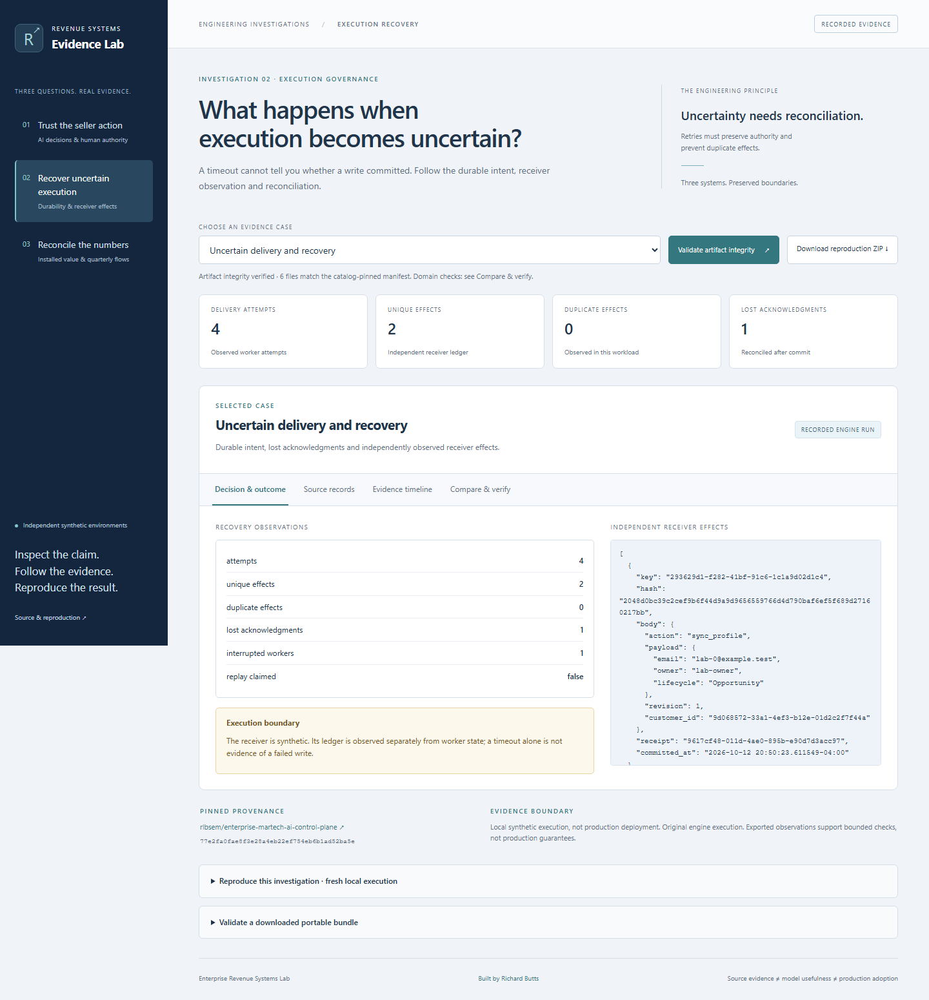
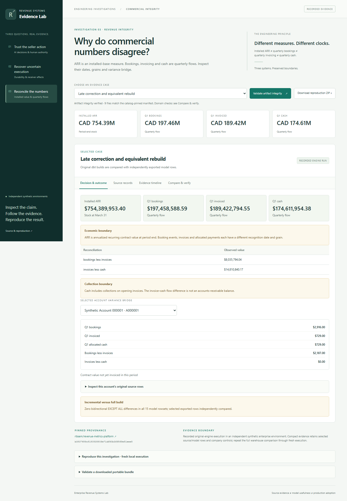
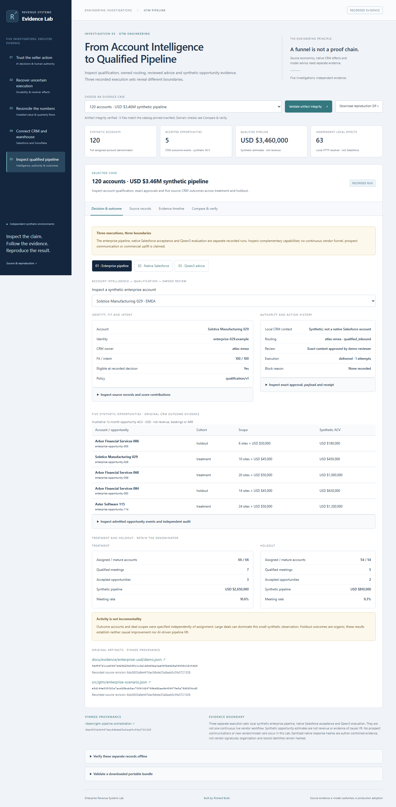

# Enterprise Revenue Systems Lab

Inspect AI seller decisions, recovery after uncertain writes, CRM-to-warehouse synchronization, GTM pipeline orchestration and the differences between bookings, invoices, cash and ARR.

An AI-generated proposal can cite the right facts and still imply an unsupported commitment. A timed-out write may already have committed. A mature SaaS company can carry $754M of ARR while booking far less in one quarter.

This application makes those boundaries inspectable. Follow source records, decisions, approval history, receiver effects and financial model outputs. Validate the recorded artifact bytes, download reproduction bundles, or execute approved scenarios against the original engines in an isolated local workspace.

**[Open the published browser explorer](https://rlbsem.github.io/enterprise-revenue-systems-lab/)** · [Claims, evidence and limitations](docs/evidence-guide.md) · [Reproduction guide](docs/reproduction.md)

The hosted explorer is a static review surface with recorded evidence. Model inference, database-backed execution and original-engine replay remain local. [Deployment and verification](docs/deployment.md).


The original three investigation screenshots are captured directly from the current static UI using existing recorded synthetic evidence. No new inference or business outcome is implied. [Screenshot provenance and desktop/mobile review](docs/evidence/visual-refresh/README.md).

## Five investigations

| Question | Working evidence | What to challenge |
|---|---|---|
| Can this AI seller action be trusted? | Actual saved Qwen3-14B output, exact citations, a reviewed edit, bound approval, synthetic CRM receipt and fresh refusal scenarios | Correct citations do not establish support for every sentence. The unsupported availability finding remains visible. |
| What happens when execution becomes uncertain? | Durable PostgreSQL intent, lost acknowledgment, an actual interrupted worker, independently observed receiver rows and reconciled receipts | A timeout is not evidence that a write failed. Idempotency depends on the receiver's actual contract. |
| Why do commercial numbers disagree? | Original enterprise sources and dbt outputs, independent CSV controls, financial bridges, late corrections and incremental/full comparisons | ARR is a period-end measure; bookings, invoices and cash are distinct flows. |
| Can a CRM action survive uncertain delivery? | [Native Salesforce and Snowflake evidence](https://github.com/rlbsem/customer-signal-activation/blob/4ac00021637b3823a8df2f5f465b528df5749f1e/docs/evidence/connected-integration/README.md): one synthetic CRM review, lost-acknowledgment recovery, exact independent readback and warehouse feedback changing `clarify_need` to `hold` | Owner-authorized synthetic policy, not human customer approval. This Lab displays recorded vendor execution without making new calls. |
| How does account intelligence become qualified pipeline? | [GTM Pipeline investigation](docs/gtm-investigation.md): a 120-account USD $3.46M synthetic scenario, separate native Salesforce Account/Contact/Task acceptance and separate actual Qwen3 responses | Three recorded execution sets, not one continuous vendor workflow. No commercial uplift or prospect communication. |

The thirteen cases draw from four pinned source repositories. The Salesforce and Snowflake case records an actual native synthetic integration; the other cases retain their separate execution boundaries. They are not a single client deployment.

## Open the application

Use Python 3.12 and Git:

```shell
python -m venv .venv
# Windows: .venv\Scripts\activate
# macOS/Linux: source .venv/bin/activate
python -m pip install -r requirements.lock
python -m pip install --no-deps --no-build-isolation -e .
revenue-lab build
revenue-lab serve
```

Open **http://127.0.0.1:8542/**. Recorded evidence requires no model, PostgreSQL server or API key. Select a case, inspect its source records and timeline, compare outcomes, validate artifact integrity and download its reproduction ZIP. The public explorer can also be served directly from `web/` as a static site.

**Hosted option:** [Open the static explorer](https://rlbsem.github.io/enterprise-revenue-systems-lab/). The [latest corrected deployment](https://github.com/rlbsem/enterprise-revenue-systems-lab/actions/runs/38495435399) succeeded, and the site owner reviewed the browser interface. Full cross-device and download-path testing remains a separate check. Recorded evidence also runs locally without a model or database.

## Execute the original systems

```shell
revenue-lab prepare seller --install
revenue-lab run seller-stale
revenue-lab run seller-suppressed
revenue-lab run seller-delivery
revenue-lab verify <new-bundle-directory>
```

These three scenarios replay an unchanged saved response through the original Workbench. Their new approval/delivery observations are real software execution; replay is explicitly labeled and does not become new inference.

The opt-in local interface, `revenue-lab serve --execute`, invokes only approved scenarios. It uses isolated workspaces, package/version checks, bounded process trees, explicit local execution authority and one execution lane. Fresh model inference requires a real configured endpoint and `SELLER_MODEL_KEY`; unavailable inference never produces fabricated success. [Full reproduction instructions](docs/reproduction.md).



## Executed evidence

- The original pinned suites passed locally: **86 Customer Signal tests, 91 Control Plane tests and 30 Revenue Metrics tests**. The Lab adds browser, artifact, domain and execution-boundary regression checks; [actual results](docs/evidence/tests.xml) and [local browser execution proof](docs/evidence/local-ui.json) are committed.
- The recovery scenario observed **four worker attempts, two unique receiver effects and zero duplicates** across one lost acknowledgment and one actual process interruption. This is a controlled failure demonstration, not a throughput benchmark.
- The established enterprise sources produce **$754,389,953.40 ARR**, **$197,458,588.59 Q1 bookings**, **$189,422,794.55 Q1 net invoicing** and **$174,611,954.38 Q1 allocated cash**. Company-wide source CSV controls agree with the original model outputs.
- The revenue execution ran **three dbt builds**, each with 15 models and 30 tests. Bidirectional `EXCEPT ALL` observed zero differences across all 15 corrected model rowsets. The opportunity daily model contains **12,470,664 rows**. The compact bundle includes selected source/model rows; repeating the entire warehouse comparison requires fresh execution.
- One additional **actual local Qwen3-14B inference** was executed, with original-engine approval/delivery and observed synthetic receiver effects. Its automatic scenario approval is not independent human review. The original 120-case comparison is separate and its unsupported-language review finding remains preserved.

The current hosted workflow status is visible in [GitHub Actions](https://github.com/rlbsem/enterprise-revenue-systems-lab/actions). Local test results do not imply a successful hosted run. [Hosted verification](docs/evidence/hosted-verification/README.md) records public-site observations separately from candidate-build checks. [Claim-to-evidence guide and limitations](docs/evidence-guide.md).



## Architecture and verification

The Lab is a companion interface and execution adapter. It calls the existing engines at exact [locked commits](sources.lock.json); it does not replace their policies or analytics. A versioned [bundle contract](schema/bundle-v1.json) records source identity, input/configuration hashes, runtime provenance, observed outcomes, limitations, artifacts and reproduction commands.

The browser checks catalog-pinned artifact integrity. The standalone verifier additionally tests selected underlying relationships: exact source quotations, approved payload identity, receiver receipts, uncertainty/recovery observations, account-level source totals and exported analytical rowsets. A self-reported success field or valid hash alone is insufficient.

The hosted explorer displays the recorded native Salesforce–Snowflake round trip and makes no vendor calls. Independent blinded seller usefulness, production deployment, stress-profile performance and commercial uplift remain outside the Lab's evidence. [Architecture and trust boundaries](docs/architecture.md).

## Validate and package

```shell
python -m playwright install chromium
python -m pytest -q
python scripts/check_repository.py
python scripts/build.py
python scripts/package.py
```

The static distribution requires no server credentials or inference service. The local execution server stays on loopback and is excluded from public hosting. [Publishing configuration and verification](docs/deployment.md).

The source engine implementations remain unchanged: [Customer Signal & Activation](https://github.com/rlbsem/customer-signal-activation), [Enterprise MarTech / AI Control Plane](https://github.com/rlbsem/enterprise-martech-ai-control-plane), [Revenue Metrics Platform](https://github.com/rlbsem/revenue-metrics-platform) and [GTM Pipeline Orchestration](https://github.com/rlbsem/gtm-pipeline-orchestration).

## GTM pipeline investigation

**From Account Intelligence to Qualified Pipeline** adds account and opportunity inspection, exact review history, native CRM operation records and preserved model failures to the existing navigation. The fifth investigation is available in this candidate build; its public-site deployment is pending review.



[Evidence boundaries and verification](docs/gtm-investigation.md) · [Screenshot provenance and tests](docs/evidence/gtm-integration/README.md). In a local preview or approved deployment, open `?case=gtm-enterprise`, `?case=gtm-salesforce` or `?case=gtm-qwen`. The browser reads existing records only; no model or Salesforce access is needed.
