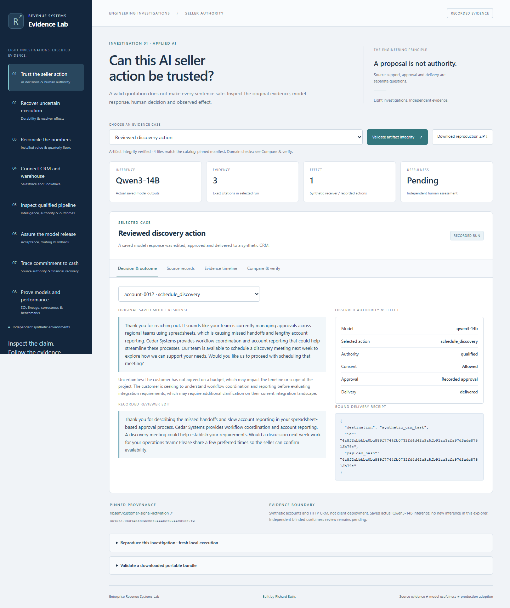
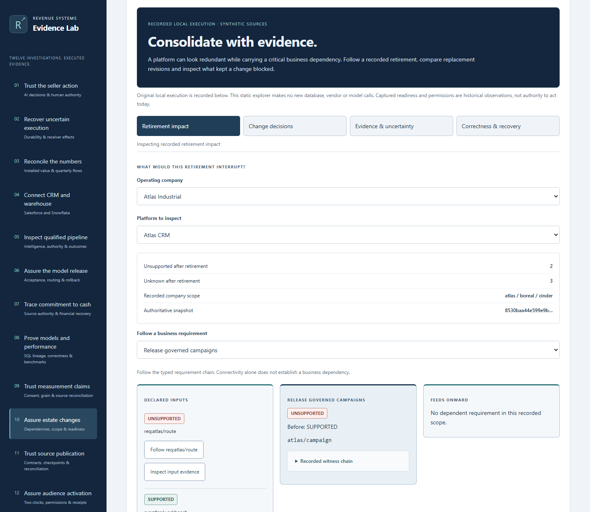
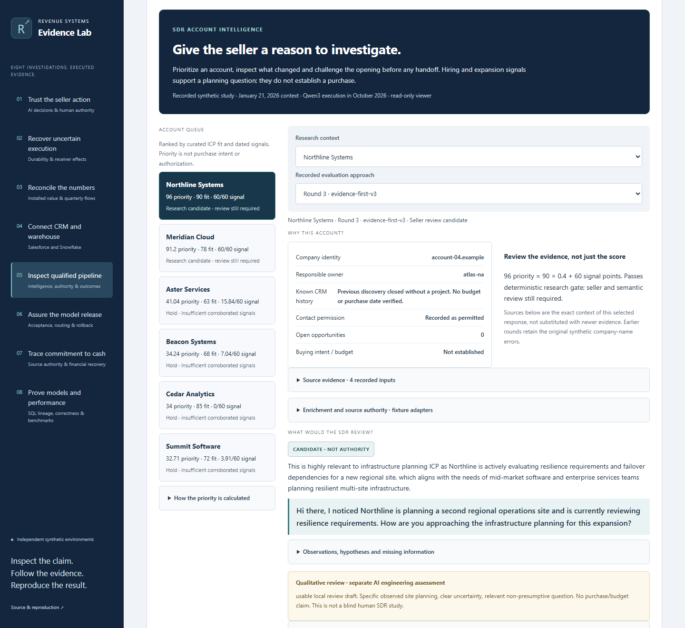
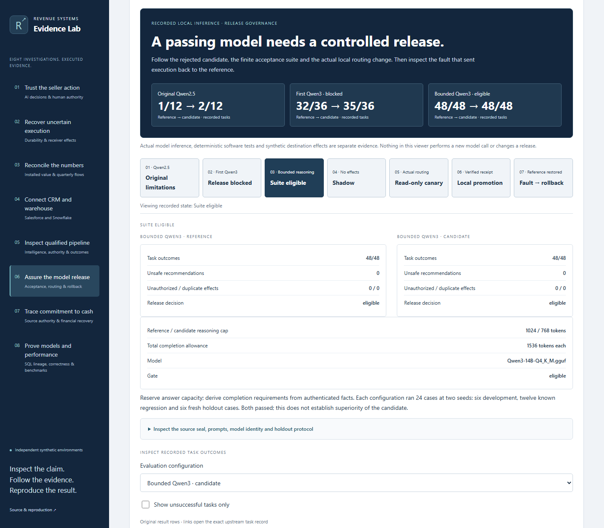
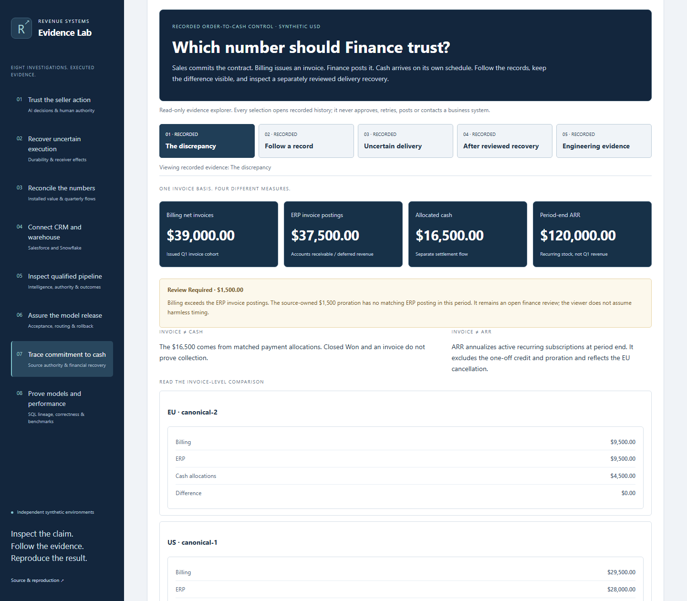
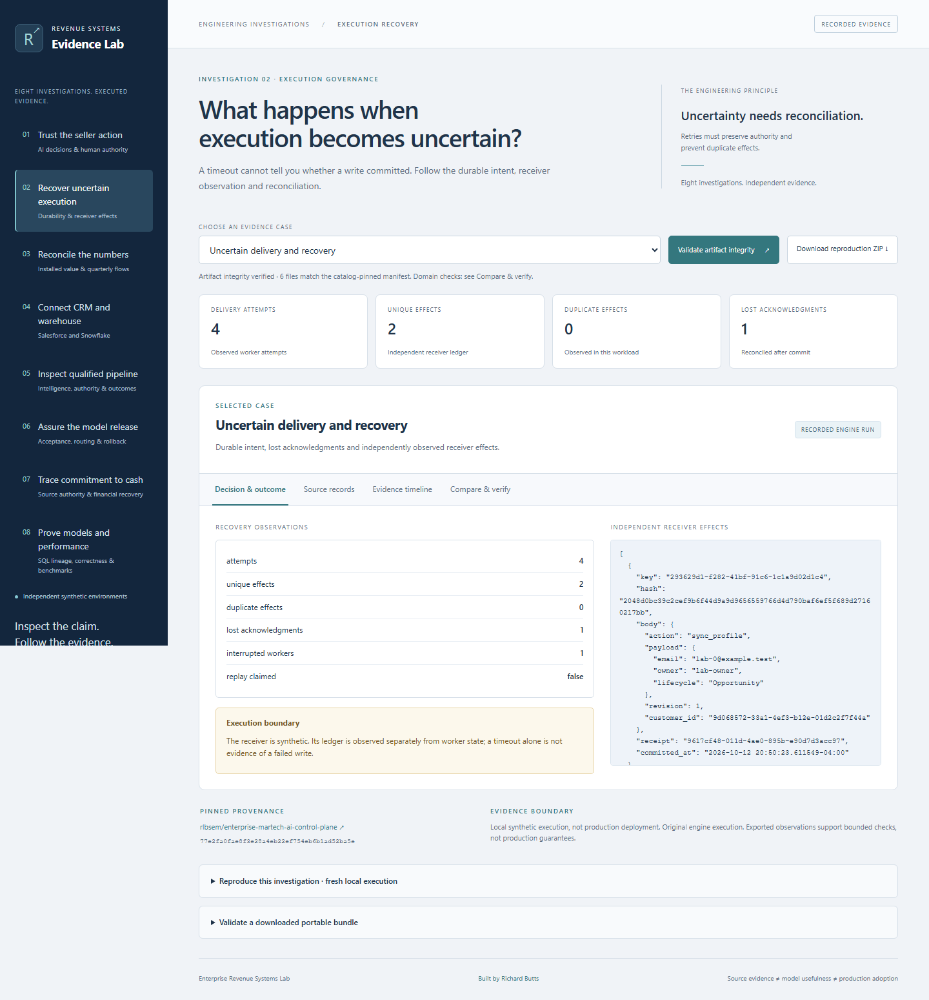
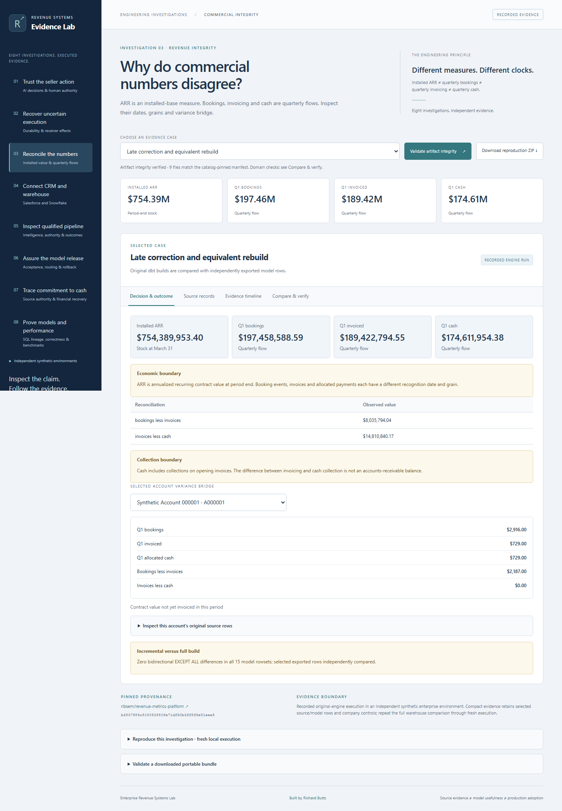
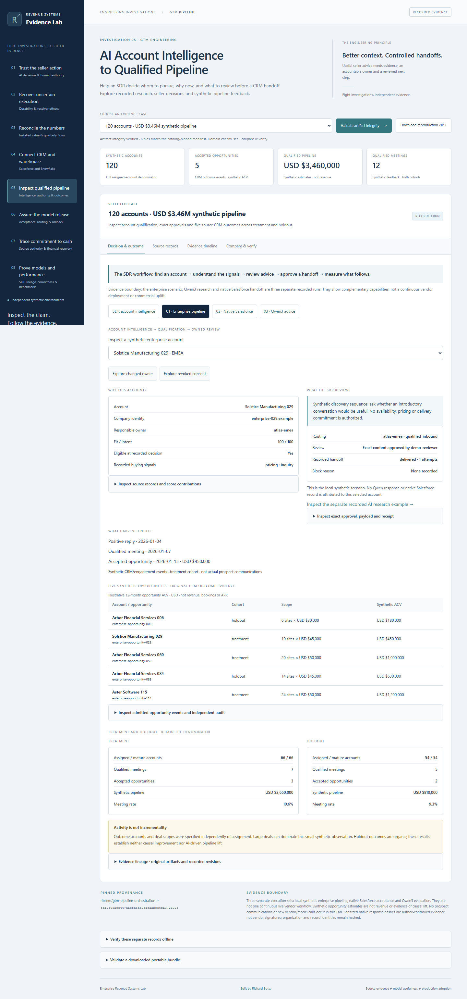

# Enterprise Revenue Systems Lab

Inspect enterprise architecture decisions, source-to-report reliability and temporal audience safety alongside AI seller decisions, execution recovery, CRM-to-warehouse synchronization and revenue integrity.

An AI-generated proposal can cite the right facts and still imply an unsupported commitment. A timed-out write may already have committed. A mature SaaS company can carry $754M of ARR while booking far less in one quarter.

This application makes those boundaries inspectable. Follow source records, decisions, approval history, receiver effects and financial model outputs. Validate the recorded artifact bytes, download reproduction bundles, or execute approved scenarios against the original engines in an isolated local workspace.

**[Open the published browser explorer](https://rlbsem.github.io/enterprise-revenue-systems-lab/)** · [Claims, evidence and limitations](docs/evidence-guide.md) · [Reproduction guide](docs/reproduction.md)

The hosted explorer is a static review surface with recorded evidence. Model inference, database-backed execution and original-engine replay remain local. [Deployment and verification](docs/deployment.md).



The first nine investigations and their captured evidence remain preserved. Three new assurance investigations add captures from the actual static application. Original captures remain archived. [Release QA and screenshot provenance](docs/release-qa-eight.md).

## Twelve investigations

| Question | Working evidence | What to challenge |
|---|---|---|
| Can this AI seller action be trusted? | Actual saved Qwen3-14B output, exact citations, a reviewed edit, bound approval, synthetic CRM receipt and fresh refusal scenarios | Correct citations do not establish support for every sentence. The unsupported availability finding remains visible. |
| What happens when execution becomes uncertain? | Durable PostgreSQL intent, lost acknowledgment, an actual interrupted worker, independently observed receiver rows and reconciled receipts | A timeout is not evidence that a write failed. Idempotency depends on the receiver's actual contract. |
| Why do commercial numbers disagree? | Original enterprise sources and dbt outputs, independent CSV controls, financial bridges, late corrections and incremental/full comparisons | ARR is a period-end measure; bookings, invoices and cash are distinct flows. |
| Can a CRM action survive uncertain delivery? | [Native Salesforce and Snowflake evidence](https://github.com/rlbsem/customer-signal-activation/blob/4ac00021637b3823a8df2f5f465b528df5749f1e/docs/evidence/connected-integration/README.md): one synthetic CRM review, lost-acknowledgment recovery, exact independent readback and warehouse feedback changing `clarify_need` to `hold` | Owner-authorized synthetic policy, not human customer approval. This Lab displays recorded vendor execution without making new calls. |
| How does account intelligence become qualified pipeline? | [GTM Pipeline investigation](docs/gtm-investigation.md): a 120-account USD $3.46M synthetic scenario, separate native Salesforce Account/Contact/Task acceptance and separate actual Qwen3 responses | Three recorded execution sets, not one continuous vendor workflow. No commercial uplift or prospect communication. |
| Can a real-model candidate be released safely? | [AI Model Release Assurance](docs/model-release-assurance.md): preserved Qwen2.5 failures, blocked 35/36 Qwen3 candidate, 48/48 paired configurations and actual local shadow/canary/promotion/rollback | Finite-suite local acceptance with synthetic effects; controlled input corruption, not production reliability or general model accuracy. |
| Why do billing and Finance disagree after a delivery recovers? | [Revenue Integrity](docs/revenue-integrity.md): authoritative invoice/ERP/cash lineage, independent receipts, a separate recorded operator recovery and an unresolved $1,500 variance | Local contract acceptance at a pinned historical source revision; recorded review states, no privileged actions or native vendor calls. |
| Are analytical models correct, and is the optimization worth keeping? | [Analytics Engineering](docs/analytics-engineering.md): 15-model SQL lineage, actual small-fixture rows, 60K/180K paired benchmarks, a rejected selective rebuild and separate native Snowflake fixture evidence | Complete comparisons were recorded upstream; the browser checks artifacts and summaries. Local timing is not native warehouse performance or commercial savings. |
| Can a measured conversion be trusted as collected money? | [First-Party Measurement](docs/measurement-integrity.md): synthetic source-to-conversion reconciliation, browser controls, five local GA4 rowsets and separate historical native Google sample queries | Measured values are claims. The Google sample is unrelated to Evermere; no production GA4 export or native dbt-bigquery acceptance. |
| Can a platform be retired without breaking an operating company? | [Enterprise Change Assurance](docs/architecture-assurance.md): recorded multi-company dependencies, proposal revisions and reviewer decisions | Captured local PostgreSQL readiness is not current change authority or operational cutover acceptance. |
| Would an incomplete or numerically wrong report be published? | [MarTech Data Reliability](docs/architecture-assurance.md): independent source deliveries, checkpoints, rejected candidates and reconciled output | Local synthetic HTTP/DuckDB execution, not native vendor data or business uplift. |
| Can late history or an old receipt authorize a new audience action? | [Temporal Audience Assurance](docs/architecture-assurance.md): two-time decisions, scoped permissions and independent effects | Recorded synthetic clocks and local services; the viewer cannot activate an audience. |

The twenty-one cases draw from ten pinned source repositories, with research imported at a separate revision. The Salesforce and Snowflake case records an actual native synthetic integration; the other cases retain their separate execution boundaries. They are not a single client deployment.

## Enterprise architecture and data assurance

Three recorded local implementations are now inspectable through the same static Lab. No installation, live service or vendor credential is required.

| Investigation | Decision to inspect | Evidence boundary |
|---|---|---|
| [Enterprise Change Assurance](docs/architecture-assurance.md#enterprise-change-assurance) · `?case=estate-assurance` | Follow company-scoped retirement impacts; compare replacement revisions and captured readiness/approval gates | Recorded PostgreSQL execution, synthetic multi-company estate; no present-day approval or external retirement |
| [MarTech Data Reliability](docs/architecture-assurance.md#martech-data-reliability) · `?case=reliability-operations` | Reject a wrong-value reporting candidate despite equal row counts; inspect source bytes, checkpoints and recovery | Recorded independent local HTTP sources and DuckDB; not native marketing-platform acceptance |
| [Temporal Audience Assurance](docs/architecture-assurance.md#temporal-audience-assurance) · `?case=temporal-assurance` | Compare original and restated history, current permission gates and independent destination receipts | Recorded local PostgreSQL/SQLite/HTTP effects; no prospect communication or present-day activation authority |



[Source pins, verification and execution boundaries](docs/architecture-assurance.md) · [Genuine screenshots and browser evidence](docs/evidence/architecture-assurance/README.md). These feature-branch investigations are not claimed to be publicly deployed; publication follows owner approval and separate hosted verification.

## First-Party Measurement — Conversion & Revenue Integrity

The ninth investigation traces synthetic Evermere contracts and payments to reported conversions. Inspect the missing $245,000 contract, missing $13,000 payment and $171,500 deposit overstatement. Explore collection decisions, consent controls, actual locally executed GA4 rowsets and the separate historical native BigQuery sample queries.

Feature route: `?case=measurement-integrity`. This change is not deployed by the feature branch. [Evidence and reproduction](docs/measurement-integrity.md).


## SDR account intelligence

The fifth investigation now includes **[SDR account intelligence](docs/sdr-account-intelligence.md)**: six explainable account priorities, forty actual Qwen3 responses, preserved failures and a separately recorded local seller decision. Select a source, compare an approach, inspect uncertainty and follow the boundary to native Salesforce or synthetic pipeline evidence.

The `?case=gtm-research` route is included in the main-branch static explorer. [Pages deployments](https://github.com/rlbsem/enterprise-revenue-systems-lab/actions/workflows/pages.yml?query=branch%3Amain) and [hosted checks](https://github.com/rlbsem/enterprise-revenue-systems-lab/actions/workflows/hosted.yml?query=branch%3Amain) show the public rollout status. The richer research desk does not execute through native Salesforce. [Source lock](sources.lock.json) · [Recorded operator proof](https://github.com/rlbsem/gtm-pipeline-orchestration/blob/81d9381169456ca8893be0ddea483296ac77e12e/docs/evidence/research/operator-proof.json).



## AI Model Release Assurance

The sixth investigation follows actual recorded model failures through finite-suite acceptance, local promotion and verified rollback. Inspect failed tasks, original model responses, independent destination receipts and the reference version used after a controlled fault. No model endpoint or credentials are needed.

Route: `?case=release-assurance`, included on `main`. [Evidence and execution boundaries](docs/model-release-assurance.md) · [Genuine screenshots and browser checks](docs/evidence/release-assurance/README.md). Pages deployment and hosted verification establish public availability separately from local checks.



## Revenue Integrity: commitment to cash

The seventh investigation follows a recorded $1,500 posting discrepancy through source lineage and a separate reviewed delivery recovery. Inspect the before/after invoice, cash and ARR measures without access to the privileged operator console. The discrepancy remains **Review Required**.

Route: `?case=revenue-integrity`, included on `main`. [Evidence and financial derivation](docs/revenue-integrity.md) · [Actual browser screenshots](docs/evidence/revenue-integrity/README.md). The source platform remains pinned to its recorded acceptance revision; this presentation update is not deployed by this PR.



## Analytics Engineering — Model Correctness & Performance

The eighth investigation connects financial grain, actual SQL/dbt dependencies and measured correctness to an engineering decision. Inspect 15 models, typed rows from an executed small fixture, six metric identities and three paired measurements at each enterprise scale. The selective candidate was rejected despite faster aggregation: total elapsed time regressed by 54.3% at 60K accounts and 31.2% at 180K accounts.

Route: `?case=analytics-engineering`, merged through PR #11. [Evidence, execution boundaries and reproduction](docs/analytics-engineering.md) · [Actual screenshots and browser verification](docs/evidence/analytics-engineering/README.md). Pages deployment and hosted verification establish public availability separately from local checks.


## Open the hosted explorer or run it locally

**No installation required:** [Open the public Engineering Evidence Lab](https://rlbsem.github.io/enterprise-revenue-systems-lab/). You can review recorded cases and evidence in your browser. The hosted site is read-only: it does not run fresh model inference or connect to live CRM and warehouse systems.

For an optional local reproduction, use Python 3.12 and Git:

```shell
python -m venv .venv
# Windows: .venv\Scripts\activate
# macOS/Linux: source .venv/bin/activate
python -m pip install -r requirements.lock
python -m pip install --no-deps --no-build-isolation -e .
revenue-lab build
revenue-lab serve
```

Once `revenue-lab serve` is running, open `http://127.0.0.1:8542/` in a browser on the **same computer**. This address is for the local preview only; public visitors should use the hosted link above. Recorded evidence requires no model, PostgreSQL server or API key. Select a case, inspect its source records and timeline, compare outcomes, validate artifact integrity and download its reproduction ZIP. The public explorer can also be served directly from `web/` as a static site.

**Publication evidence:** [GitHub Pages deployments](https://github.com/rlbsem/enterprise-revenue-systems-lab/actions/workflows/pages.yml?query=branch%3Amain) and [hosted verification](https://github.com/rlbsem/enterprise-revenue-systems-lab/actions/workflows/hosted.yml?query=branch%3Amain) show current results. Recorded evidence can also be explored locally without a model or database.

## Execute the original systems

```shell
revenue-lab prepare seller --install
revenue-lab run seller-stale
revenue-lab run seller-suppressed
revenue-lab run seller-delivery
revenue-lab verify <new-bundle-directory>
```

These three scenarios replay an unchanged saved response through the original Workbench. Their new approval/delivery observations are real software execution; replay is explicitly labeled and does not become new inference.

The opt-in local interface, `revenue-lab serve --execute`, invokes only approved scenarios. It uses isolated workspaces, package/version checks, bounded process trees, explicit local execution authority and one execution lane. Fresh model inference requires a real configured endpoint and `SELLER_MODEL_KEY`; unavailable inference never produces fabricated success. [Full reproduction instructions](docs/reproduction.md).



## Executed evidence

- The original pinned suites passed locally: **86 Customer Signal tests, 91 Control Plane tests and 30 Revenue Metrics tests**. The Lab adds browser, artifact, domain and execution-boundary regression checks; [actual results](docs/evidence/tests.xml) and [local browser execution proof](docs/evidence/local-ui.json) are committed.
- The recovery scenario observed **four worker attempts, two unique receiver effects and zero duplicates** across one lost acknowledgment and one actual process interruption. This is a controlled failure demonstration, not a throughput benchmark.
- The established enterprise sources produce **$754,389,953.40 ARR**, **$197,458,588.59 Q1 bookings**, **$189,422,794.55 Q1 net invoicing** and **$174,611,954.38 Q1 allocated cash**. Company-wide source CSV controls agree with the original model outputs.
- The revenue execution ran **three dbt builds**, each with 15 models and 30 tests. Bidirectional `EXCEPT ALL` observed zero differences across all 15 corrected model rowsets. The opportunity daily model contains **12,470,664 rows**. The compact bundle includes selected source/model rows; repeating the entire warehouse comparison requires fresh execution.
- One additional **actual local Qwen3-14B inference** was executed, with original-engine approval/delivery and observed synthetic receiver effects. Its automatic scenario approval is not independent human review. The original 120-case comparison is separate and its unsupported-language review finding remains preserved.

The current hosted workflow status is visible in [GitHub Actions](https://github.com/rlbsem/enterprise-revenue-systems-lab/actions). Local and hosted checks answer different questions. [Hosted verification](docs/evidence/hosted-verification/README.md) records public-site observations separately from source and build checks. [Claim-to-evidence guide and limitations](docs/evidence-guide.md).



## Architecture and verification

The Lab is a companion interface and execution adapter. It calls the existing engines at exact [locked commits](sources.lock.json); it does not replace their policies or analytics. A versioned [bundle contract](schema/bundle-v1.json) records source identity, input/configuration hashes, runtime provenance, observed outcomes, limitations, artifacts and reproduction commands.

The browser checks catalog-pinned artifact integrity. The standalone verifier additionally tests selected underlying relationships: exact source quotations, approved payload identity, receiver receipts, uncertainty/recovery observations, account-level source totals and exported analytical rowsets. A self-reported success field or valid hash alone is insufficient.

The hosted explorer displays the recorded native Salesforce and Snowflake round trip and makes no vendor calls. Independent blinded seller usefulness, production deployment, stress-profile performance and commercial uplift remain outside the Lab's evidence. [Architecture and trust boundaries](docs/architecture.md).

## Validate and package

```shell
python -m playwright install chromium
python -m pytest -q
python scripts/check_repository.py
python scripts/build.py
python scripts/package.py
```

The static distribution requires no server credentials or inference service. The local execution server stays on loopback and is excluded from public hosting. [Publishing configuration and verification](docs/deployment.md).

The source engine implementations remain unchanged: [Customer Signal & Activation](https://github.com/rlbsem/customer-signal-activation), [Enterprise MarTech / AI Control Plane](https://github.com/rlbsem/enterprise-martech-ai-control-plane), [Revenue Metrics Platform](https://github.com/rlbsem/revenue-metrics-platform) and [GTM Pipeline Orchestration](https://github.com/rlbsem/gtm-pipeline-orchestration).

## GTM pipeline investigation

**AI Account Intelligence to Qualified Pipeline** lets an SDR inspect account signals, review AI research and a suggested next step, check the responsible owner and CRM handoff, and follow synthetic meeting/opportunity feedback to the existing navigation. The fifth investigation is part of the main-branch explorer; public availability is tracked by the Pages and hosted-verification workflows.



[Evidence boundaries and verification](docs/gtm-investigation.md) · [Screenshot provenance and tests](docs/evidence/gtm-integration/README.md). In the explorer, open `?case=gtm-enterprise`, `?case=gtm-salesforce` or `?case=gtm-qwen`. The browser reads existing records only; no model or Salesforce access is needed.

The PR #10 captures below remain historical seven-investigation records. Current eight-investigation screenshots and checks are linked in [release QA](docs/release-qa-eight.md). These archived screenshots came from real Chromium rendering of the recorded evidence. [Presentation checks](docs/images/current-presentation/provenance.json), [research](docs/images/current-research/provenance.json), [model release](docs/images/current-release/provenance.json) and [revenue integrity](docs/images/current-integrity/provenance.json) retain capture hashes and browser checks. Original captures and execution records remain unchanged. No new model or vendor execution is implied.
