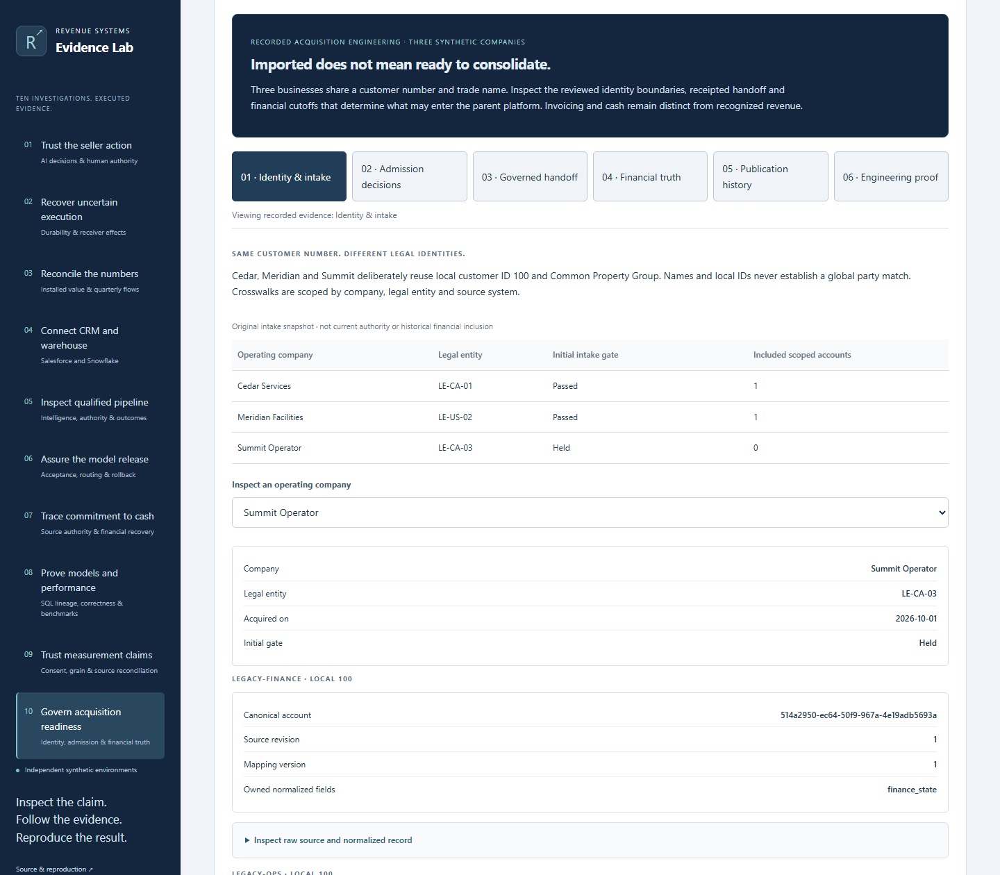
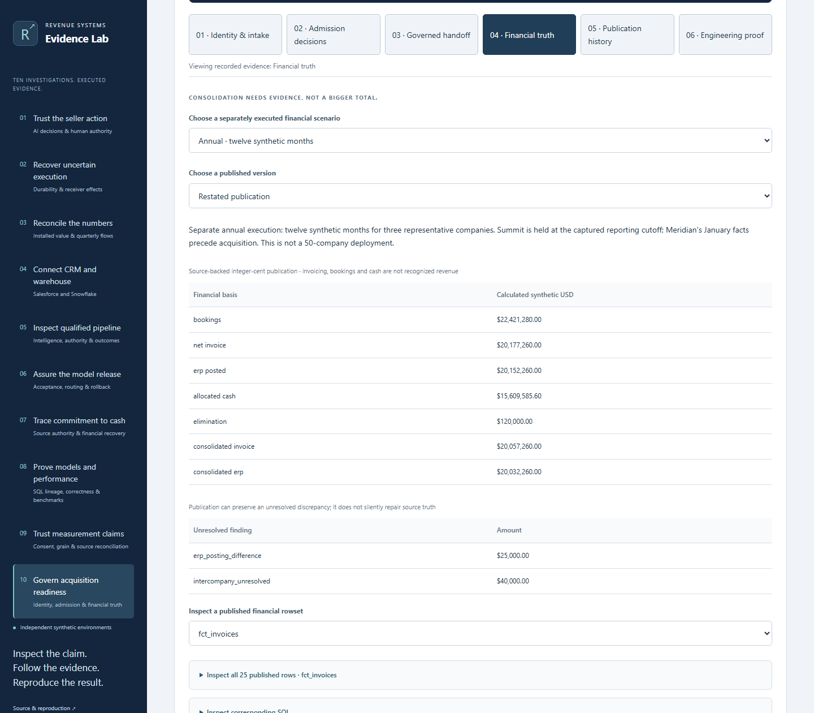
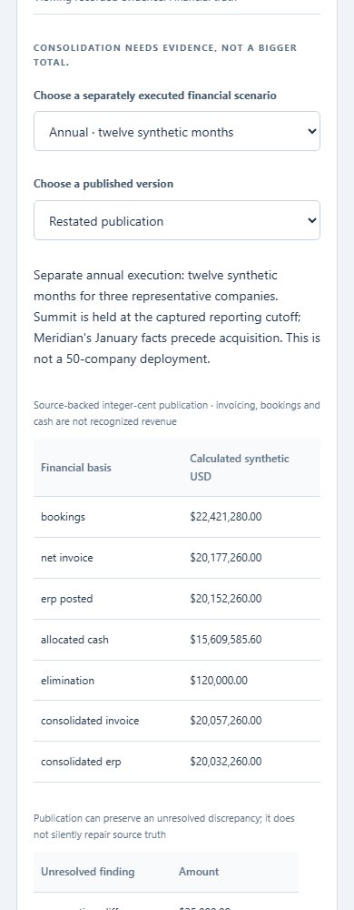

# M&A systems integration: readiness and financial governance

An acquired business is not safe to consolidate merely because its files were imported. This static investigation exposes the actual local implementation's identity, source-coverage, authorization and financial-publication boundaries.

Route: `?case=acquisition-governance`. The feature is not deployed by this branch.

## Inspect six engineering decisions

1. **Identity & intake:** Cedar, Meridian and Summit reuse local customer ID `100` and a trade name. Their legal entities, canonical accounts, source schemas, field ownership and crosswalks remain separate. Quarantined ambiguity is preserved, not silently matched by name.
2. **Admission decisions:** inspect original held/admitted gates, exact coverage, rejected identity proposals, corrected legal-entity facts and mapping version 2 resnapshot. A review approval and a persisted ready flag cannot independently establish readiness. Separately recorded states are not one current live company state.
3. **Governed handoff:** inspect frozen intent, payload identity, independent receipt/business-record readback, lost acknowledgment, duplicate prevention, current authorization checks, three-attempt exhaustion and actual worker termination. Historical reconciliation does not authorize another write.
4. **Financial truth:** choose the selected-period or annual scenario and original/restated publication. Inspect complete published rowsets, SQL, raw source events, frozen input lineage and reporting exclusions. All values derive from integer cents; invoicing, bookings and allocated cash are not recognized revenue.
5. **Publication history:** inspect the reporting cutoff, immutable original, late restatement bridge, rejected source updates and an invalid candidate that failed dbt gates without publication.
6. **Engineering proof:** inspect nine SQL/dbt models, historical software/browser evidence, independent Python financial observations and recorded Pass 5 findings. The adversarial review is AI-led, not independent human security certification.

## Separate financial executions

| Synthetic USD | Selected period: original / restated | Annual: original / restated |
|---|---|---|
| Consolidated net invoicing | $368,000 / $388,000 | $20,012,260 / $20,057,260 |
| Allocated cash | $230,000 / $230,000 | $15,609,585.60 / $15,609,585.60 |
| Preserved ERP difference | $5,000 | $25,000 |
| Unsupported intercompany candidate | $8,000 | $40,000 |

These are three representative fictional companies, not a real 50-company deployment. The annual scenario excludes Summit's held facts and Meridian's pre-acquisition January facts at its captured cutoff. It is separate from the selected-period governed-delivery and financial runs. A company becoming admitted later cannot rewrite inclusion in an earlier publication.

## Provenance and verification

Source pin: [`3a1d6d7de9447a101f8f8414c50ace9f2171ebc3`](https://github.com/rlbsem/enterprise-acquisition-onboarding/tree/3a1d6d7de9447a101f8f8414c50ace9f2171ebc3).

[39 original artifacts and per-file hashes](../web/evidence/acquisition-governance/upstream.json) retain exact source bytes. Import pin and historical execution revisions are different fields. [Bundle contract](../web/evidence/acquisition-governance/bundle.json) binds artifacts to the source lock. [Recorded delivery](../web/evidence/acquisition-governance/governance.json), [selected-period publications](../web/evidence/acquisition-governance/selected-period.json) and [annual publications](../web/evidence/acquisition-governance/annual.json) remain separate originals.

Fresh Lab verification independently selects accepted source revisions at each cutoff, checks frozen input coverage and hashes, and invokes a byte-exact vendored copy of the source's pure Python financial oracle. That oracle is independent of dbt SQL; it is not a newly invented accounting specification. All seven published rowsets are compared for both versions of both scenarios, alongside recorded nine-model/nine-test build gates. This is fresh offline recalculation, not a fresh dbt publication.

[Fresh disposable-checkout source regression](evidence/acquisition-governance/source-regression.json) records 83 actual passing tests using local PostgreSQL, HTTP and dbt. The original [62-test source acceptance](../web/evidence/acquisition-governance/software.json) and 53 source-console browser observations remain historical. The original software record contains an older scope note; it is preserved rather than relabeled as a new certification. [Genuine Lab screenshot provenance](evidence/acquisition-governance/browser.json) documents the new static interface checks.

[Preservation inventory](evidence/acquisition-governance/preserved-files.json) and [capture-time UI snapshot](evidence/acquisition-governance/prior-ui.json) protect all nine previous investigations and their historical evidence. No source repository or GitHub profile files were changed.

## Reproduce safely

From the Lab checkout, with `PYTHONPATH=src` where needed:

```text
python -m pip install -r requirements.lock
python -m revenue_lab.cli verify web/evidence/acquisition-governance
python scripts/build.py
python scripts/capture_acquisition.py --images .cache/acquisition/screenshots --output .cache/acquisition/browser.json
```

Browser checks require Playwright Chromium. The public browser requires no Python, database, credentials or cloud access. Source tests can be repeated from a disposable checkout of the pinned Acquisition Onboarding repository using its locked dependencies and local PostgreSQL prerequisites; never use production systems. The Lab importer is `python scripts/import_acquisition.py <pinned-source-checkout>` and preserves the separate fresh regression record.

No native vendor connections, privileged public controls, production deployment, statutory accounting, universal exactly-once guarantee or human security certification are demonstrated.




