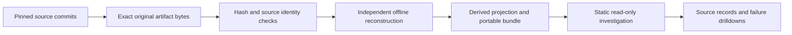

# Enterprise architecture and data assurance

Three read-only investigations make architecture consequences, publication controls and temporal activation decisions inspectable without running the source systems. Each starts with a business decision, then exposes recorded failures, source records and recovery outcomes. All company identities, audiences and financial values are synthetic.

Routes work in the local static build. This feature does not publish a Pages deployment. After an owner-approved merge, independently verify the public routes before treating them as hosted entry points.

## Enterprise Change Assurance

Route: `?case=estate-assurance` · [Source implementation and architecture](https://github.com/rlbsem/martech-estate-impact/tree/11890321d8cd6c164da236cad7896d00b6e0938e)

Retiring a platform is a company-scoped dependency decision, not a count of apparently redundant applications. Select an operating company and a collected platform; follow the declared inputs, requirement state and onward dependencies. Inspect source witnesses, disputed ownership and missing inventory. Compare immutable replacement revisions: repairing an interface does not resolve missing operational evidence or grant change authority.

The capture contains four company scopes, eight business requirements and thirteen proposal revisions, including six recorded retirement previews. The upstream recursive oracle records 112 requirement outcomes. A scoped Boreal reassignment was accepted; failed retirement and replacement decisions remain visible. The viewer does not grant present-day authorization. Captured clocks, evidence freshness and reviewer permissions describe the original run.

Original source: [run-03 evidence](https://github.com/rlbsem/martech-estate-impact/tree/11890321d8cd6c164da236cad7896d00b6e0938e/docs/evidence/change-assurance/run-03). The Lab verifies snapshot/proposal binding, recorded full requirement states and oracle comparisons. It does not rerun PostgreSQL governance or perform a cutover.

## MarTech Data Reliability

Route: `?case=reliability-operations` · [Source implementation and architecture](https://github.com/rlbsem/martech-data-reliability/tree/225964aead1a3f697007605534613f5a813aaed9)

A delivered source feed is not automatically a safe report. Inspect the six published campaign/day rows, then select the equal-count, wrong-value candidate. Independent reconciliation finds a one-cent discrepancy; the failed publication attempt remains recorded. Other candidates expose source outages, stale coverage, unknown references, unsupported schemas and a source change during publication.

Three separately persisted local HTTP sources supplied eleven retained deliveries. The browser exposes exact source bytes, source-issued acknowledgments and checkpoint positions. The offline verifier independently reconstructs the latest source versions, tombstones and campaign/day aggregates. The recorded final report contains USD $410.00 spend, six conversions and USD $1,150.00 reported closed-won CRM value. These are different synthetic measures; CRM value is neither cash nor causal marketing lift.

Original source: [operations run02](https://github.com/rlbsem/martech-data-reliability/tree/225964aead1a3f697007605534613f5a813aaed9/docs/evidence/operations/run02). Original process-death evidence remains separate. Source SQLite services and the DuckDB warehouse ran locally; this is not native advertising, web-analytics or CRM vendor acceptance.

## Temporal Audience Assurance

Route: `?case=temporal-assurance` · [Source implementation and architecture](https://github.com/rlbsem/temporal-customer-audiences/tree/5488c4796b6789d4df470d77ac12f9ee4a0c18bc)

Business time answers which facts apply; knowledge time answers what was known when the decision was made. Select Atlas or Nova and a scoped person. Compare original and restated publications, then inspect separately whether the current recorded permission permits an action. A historical receipt proves an old effect; it cannot authorize a new one.

The upstream capture has 164 historical decisions, twenty current eligibility rows, seventeen intents and eleven independently stored effects. The late restatement generated zero new HTTP actions. Lost-acknowledgment recovery is supported by a matching receiver effect and business-record hash. Negative observations before protective remediation remain inspectable. Missing final destination rows are explicitly **UNOBSERVED**, rather than reported as synchronized.

Original source: [activation run02](https://github.com/rlbsem/temporal-customer-audiences/tree/5488c4796b6789d4df470d77ac12f9ee4a0c18bc/docs/evidence/activation-assurance/run02). The Lab independently reconstructs historical membership and current recorded eligibility from scoped facts, coverage and permission revisions. These are controlled synthetic clocks and actual local PostgreSQL/SQLite/HTTP execution, not present-day communication authority or native destination-vendor acceptance.

## Evidence path



Twenty-four original source files are imported byte-for-byte, including selected SQL and Python contracts. `upstream.json` identifies every original path and SHA-256. `sources.lock.json` binds each import to the exact repository and revision; bundle manifests bind the original and explicitly derived files. Source URLs never follow a moving branch. Browser validation hashes artifacts; Python verification additionally checks semantic relationships. Neither performs a new vendor call or source-system execution.

The prior nine investigations, eighteen case records and 476 historical evidence/image files remain byte-identical. The baseline inventory is [preserved-main.json](evidence/architecture-assurance/preserved-main.json); it is a preservation check, not new source-engine evidence. New screenshots are separate records.

## Reproduce verification

From the Lab checkout, install `requirements.lock` and install Chromium with `python -m playwright install chromium`. Then:

```text
python -m pytest -q --basetemp .cache/tests
python scripts/build.py
python scripts/capture_assurance.py --output .cache/assurance/browser.json --images .cache/assurance/images
python scripts/check_repository.py
python scripts/package.py
```

The capture command serves the actual `dist/` under the GitHub Pages path prefix. It tests source selections, negative decisions, receipts, five viewport sizes, keyboard-accessible controls and WCAG-tagged automated accessibility states. Automated accessibility checks supplement human visual review; they do not establish universal usability.

To verify a downloaded bundle, use `python -m revenue_lab.cli verify <extracted-folder>`. To reproduce the original systems, follow the exact source revision and source commands in that bundle. The browser offers offline verification and downloads only: it cannot change a platform, publish a warehouse report or activate an audience.

[Browser evidence and screenshots](evidence/architecture-assurance/README.md) · [Overall evidence guide](evidence-guide.md) · [Deployment security boundary](deployment.md)
