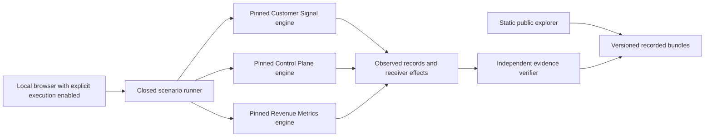

# Evidence before conclusions

The public application reads portable evidence from three separate synthetic environments. The local runner creates isolated workspaces and calls the original Python/dbt engines at pinned Git commits. The Lab does not define seller policy, govern CRM fields or calculate the displayed production-style metrics itself.

The arrows represent evidence flow. They do not represent an integrated client deployment or shared synthetic company.

## Trust boundaries

The source lock fixes repositories and commits. Tracked source modifications prevent execution. Source package versions are checked against each repository's complete lock before running the engine. New execution gets a unique workspace and a bounded timeout. An unsuccessful process never becomes a successful bundle.

Local execution requires an explicit server flag, loopback binding, expected Host and Origin, an ephemeral request token, a closed scenario contract and a single execution lane. A session permits at most 20 runs. The browser cannot choose executable paths or arbitrary commands. Model calls require an explicit loopback endpoint and the source engine's authentication key.

Control Plane uses a dedicated local PostgreSQL cluster with `lab_admin`. Each run creates its own database, calls the original migrations, separates application and receiver roles, and drops only that uniquely named database afterward. The test suite uses a separate disposable database ending in `_test`. Do not point these routines at a production cluster.

## Verification boundaries

The catalog binds each recorded manifest hash. Browser validation recomputes every artifact hash and size. The standalone verifier additionally checks exact source spans, approved payload and receipt identities, refusal/effect relationships, recovery intent/receiver identities and selected financial arithmetic.

A file hash establishes artifact integrity relative to its trusted reference. It does not establish truthful authorship, independent usefulness or production operation. Recorded bundles are author-controlled execution evidence. A visitor obtains stronger reproduction evidence by running the pinned engines locally or in a fork's CI.

The revenue runner independently reads the entire enterprise CSV source set, checks four company measures and performs bidirectional `EXCEPT ALL` comparisons across all 15 models. The compact bundle retains control totals and selected account/source/model rows. Its standalone verifier recomputes the selected account bridges and compares the exported rowsets. Rechecking all enterprise rows requires fresh execution; the compact bundle does not contain the multi-million-row warehouse.

The Qwen review case preserves a mechanically passing proposal with unsupported availability language. The verifier confirms the original quotations and the presence of the review finding; it does not claim to solve general semantic entailment.

## Maintenance

There are three bounded adapters and one evidence contract. Source changes require a deliberate lock update, new execution and new evidence. Recorded UI interactions never call the model or destination. Live model output is nondeterministic: source generation and financial results are deterministic, while fresh model wording need not match an archived response.
