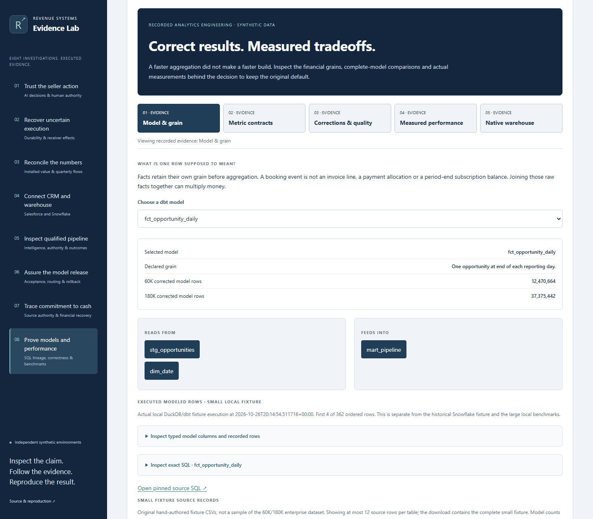
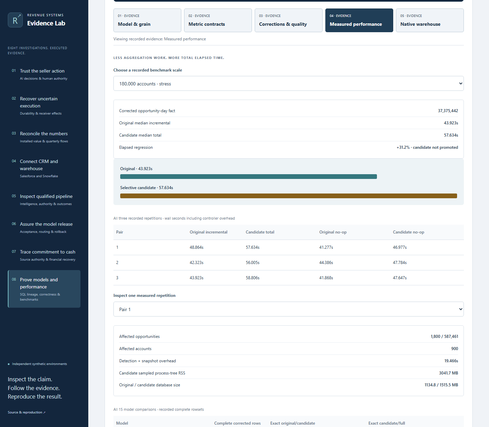

# Analytics investigation execution evidence

The [browser record](browser.json) captures the real `dist/` application served under `/enterprise-revenue-systems-lab/`, including the Pages subpath. It is a local execution, not evidence of a public deployment.

- [Full local regression](local-tests-complete.json): **187 tests passed**, zero failures/errors/skips, including all original cases, new negative-evidence tests, browser interactions, static subpath/download verification and execution boundaries.
- 40 layout/contrast checks: five stages plus the three shared evidence tabs at widths 1440, 1024, 768, 390 and 320.
- Ten automated accessibility states: all five stages at desktop and mobile, using the recorded, hash-pinned axe 4.10.3 script. Zero automated violations is not a complete manual accessibility certification.
- Three unedited Chromium viewport screenshots; exact browser version, source hashes, image hashes and dimensions are in the record.
- No browser script errors, nonlocal requests or HTTP writes in the capture. The public investigation has no live warehouse endpoint.

[Mobile viewport](../../images/analytics-engineering/analytics-engineering-mobile.png) · [Fresh small-fixture execution](fixture-execution.json) · [Seven-investigation preservation hashes](preserved-files.json) · [Previous source UI](prior-ui.json).

Reproduce the browser verification with `python scripts/capture_analytics.py --images .cache/analytics/screenshots --output .cache/analytics/browser.json`. Ordinary tests and CI write new captures under `.cache`, preserving these records.

The initial browser attempt exposed missing semantic section headings, which were corrected. An initial full-suite run passed 180 tests and failed one shared static-case test because the new case's offline-verification label was not yet registered in its expectation. That expectation now explicitly covers this investigation; the original seven cases and their assertions remain. A subsequent run passed 184 tests with one failed new-test selector after the modeled-row disclosure was added; the selector now targets its exact SQL disclosure. The final full rerun passed all 185 tests.

[Investigation guide and execution boundaries](../../analytics-engineering.md). Native Snowflake, historical local benchmarks, the current small local fixture and this browser capture are distinct evidence sets. No commercial outcomes or new large benchmark results are claimed.

The [first 185-test local pass](local-tests.json) remains unchanged. [Initial GitHub CI](https://github.com/rlbsem/enterprise-revenue-systems-lab/actions/runs/40395218007) correctly rejected evidence that Git had normalized from historical CRLF to LF. The original source hashes were not relaxed. The new bundle now uses the same byte-preserving Git attributes as the prior imported investigations; a regression checks all 46 original artifact blobs in Git’s index. The subsequent full local run passed 186 tests.

[Corrected-byte local run: 186 tests](local-tests-byte-safe.json) remains preserved. The next [Linux CI run](https://github.com/rlbsem/enterprise-revenue-systems-lab/actions/runs/40415604277) passed those 186 tests, then exposed the shared capture runner’s missing eighth-case registration. Both its case registry and offline-label expectation now include Analytics Engineering. A registry coverage regression was added. [All five capture workflows passed locally](capture-workflows.json), followed by the complete 187-test pass recorded above.
