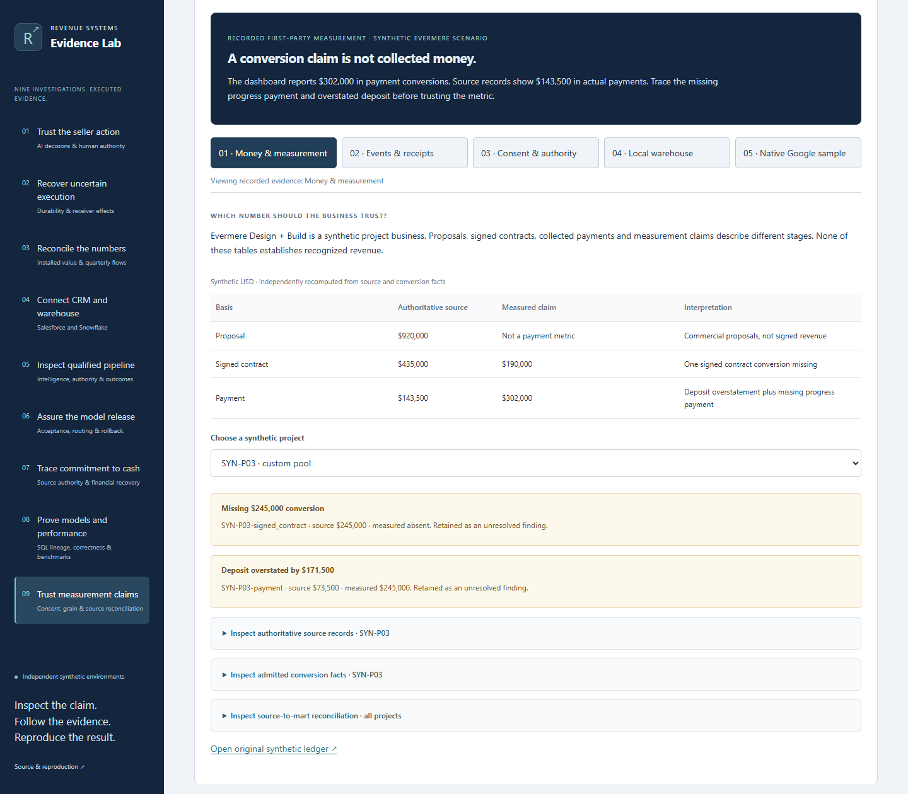
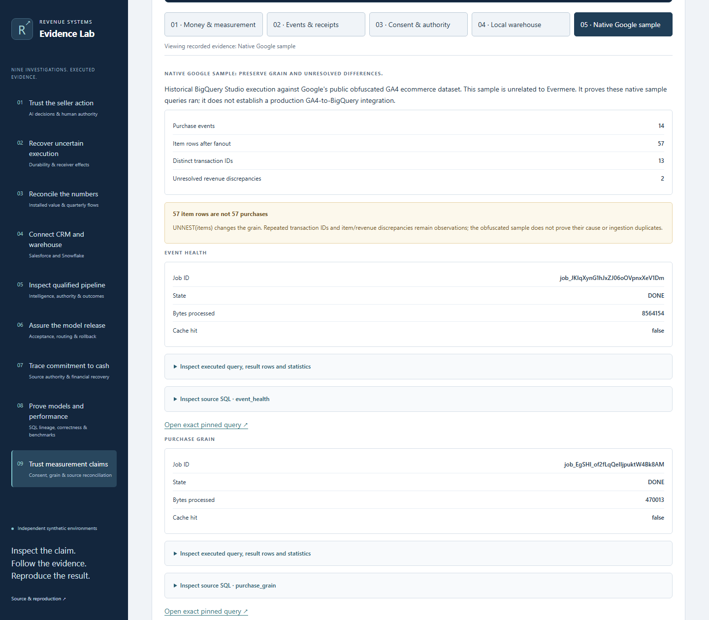
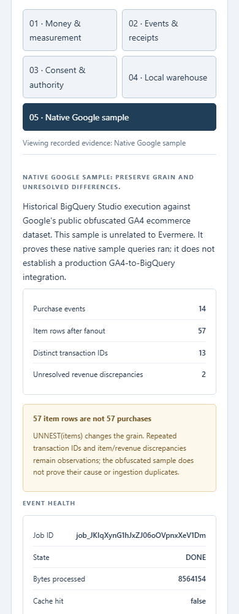

# First-party measurement: conversion and revenue integrity

A reported conversion can overstate cash even when the event pipeline works. This investigation reconciles the synthetic Evermere Design + Build source ledger against admitted conversion facts before treating any metric as money.

Route: `?case=measurement-integrity`. The feature is prepared for review, not deployed by this branch.

## Inspect the evidence

- **Money & measurement:** choose one of five projects; inspect source facts, admitted conversions and unresolved findings. Proposals $920,000, signed contracts $435,000 and payments $143,500 are separate bases. Measured contract and payment claims are $190,000 and $302,000. All amounts are synthetic USD, not recognized revenue or customer results.
- **Events & receipts:** filter the original 29 fixture decisions, follow identities to the 19 admitted events and inspect rejection without retaining rejected payloads. The later browser exercise has separate counts.
- **Consent & authority:** original real-browser local checks cover suppression, revocation, delayed grants, lost acknowledgment, bounded exhaustion, schema drift and trusted offline authority. The Lab does not collect events.
- **Local warehouse:** inspect SQL, seeds and every row in five fresh local synthetic GA4 model outputs. A late historical event and corrected purchase survive incremental processing; replay is unchanged and the independent full-build rowsets match. Two transaction flags and one revenue discrepancy remain. Nine separate Evermere modeled rowsets are also inspectable.
- **Native Google sample:** original BigQuery Studio queries observed 14 purchases, 57 nested item rows, 13 transaction IDs and two unresolved item/revenue disagreements. Inspect exact SQL, job IDs and independently captured metadata. The obfuscated public sample is not Evermere or a production export; repeated IDs do not prove ingestion duplicates.

## Source and execution boundaries

Source pin: [`88a197c761cfd167c19e3d23039948ffe6bb7f2b`](https://github.com/rlbsem/first-party-measurement-assurance/tree/88a197c761cfd167c19e3d23039948ffe6bb7f2b).

[Import inventory and per-file hashes](../web/evidence/measurement-integrity/upstream.json) includes exact original records, versioned contracts, SQL, GA4 configuration/tests and seeds. [Bundle contract](../web/evidence/measurement-integrity/bundle.json) binds them to the source lock. [Fresh local execution](evidence/measurement-integrity/fixture-execution.json) contains all five rowsets, typed columns, source hashes and independent full-build outputs. [Browser capture provenance](evidence/measurement-integrity/browser.json) binds the new screenshots to the UI source.

Historical records remain byte-exact. A [preservation inventory](evidence/measurement-integrity/preserved-files.json) protects every prior evidence/image file from the eight-investigation baseline. Historical capture checks bind to their capture-time source snapshot, not to today's changed UI.

No new BigQuery query, model inference, Measurement Protocol validation, published GTM container or production deployment occurred. Native dbt-bigquery acceptance remains unexecuted. Reported Google bytes billed are job statistics, not proof of charges.

## Reproduce offline checks

From the Lab checkout:

```text
python -m pip install -r requirements.lock
python -m revenue_lab.cli verify web/evidence/measurement-integrity
python scripts/build.py
python scripts/capture_measurement.py --images .cache/measurement/screenshots --output .cache/measurement/browser.json
```

Use `PYTHONPATH=src` where the package is not installed. Browser capture needs Playwright Chromium. Artifact downloads work without Python or credentials.

To repeat the small local warehouse execution, use the source repository's pinned DuckDB/dbt dependencies in a separate environment. The runner exports the exact pinned configuration, macros, tests, SQL and seeds from the verified bundle into a new disposable directory:

```text
python scripts/execute_measurement_fixture.py --workspace <new-disposable-directory>
python scripts/import_measurement.py <pinned-source-git-checkout>
python scripts/build.py
```

The runner refuses an existing workspace, verifies all exported input bytes and always selects the local target. It executes original source gates, independently compares physical databases and captures portable rows. No credentials or cloud queries are needed. This does not reproduce native historical Google jobs.





## Updated warehouse verification

The same investigation now includes `?case=warehouse-verification`, importing the merged native read-only SQL comparisons, independent source signatures, corrected regression guard and separate complete local dbt oracle acceptance. [Exact source pins, scope and remaining native dbt limitation](integration-economics.md#ga4-warehouse-verification). The original conversion case, local fixture execution and all historical files on this page remain unchanged. No native dbt-BigQuery build or MERGE is claimed.
