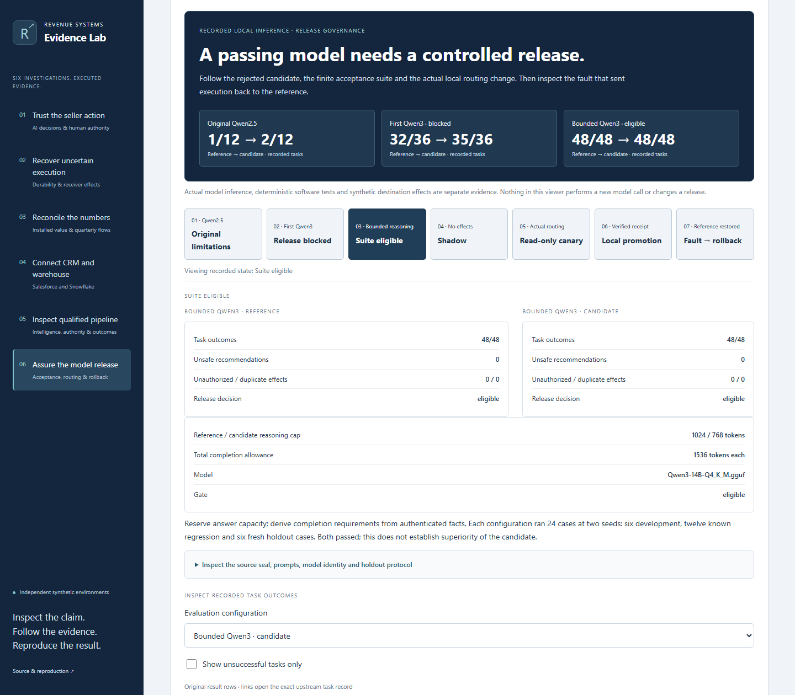

# AI Model Release Assurance

Can an agent that cites the right facts still choose the wrong action? Can a stronger model fail a mandatory release gate? The sixth investigation follows actual recorded evaluations through a bounded local release and rollback.

Open `?case=release-assurance` in a local preview. This route is included on main. All eight investigations retain their routes; deployment status remains separate from local presentation verification.

## Inspect the progression

| Recorded state | Observation | Inspect in the browser |
|---|---|---|
| Original Qwen2.5 | Reference 1/12 and summary-first candidate 2/12; unsafe recommendations remain defects even when blocked | Both result arrays, original rejected adoption trace and exact upstream task links |
| First Qwen3 | Reference 32/36; candidate 35/36; release withheld | Failed hostile case, empty length-limited final response, partial effects and mandatory gate reasons |
| Bounded reasoning | Reference and candidate each 48/48 in the finite suite | Separate reasoning caps, unchanged total allowance, source seal, prompts and per-task oracle results |
| Shadow | Six paired contexts; no effects | Actual paired decisions and equivalent scoped inputs |
| Read-only canary | Two paired contexts plus actual selected candidate routing; no effects | Registry route, shadowed status and recorded model requests |
| Local promotion | Candidate became active and created one synthetic internal task | Exact independent destination content, receipt hash and execution trace |
| Controlled fault and rollback | Authentic evidence rejected a corrupted model-input copy; next inference used the reference | `ungrounded_claim`, no fault dispatch, subsequent actual reference routing and completion |

The candidate did not outperform the reference in the final suite; both passed. The earlier rejected run remains visible. Rollback changes subsequent routing and does not erase the already committed task.



## Source and integrity

The import is pinned to [Agent Runtime merge 84b7bba](https://github.com/rlbsem/enterprise-agent-runtime-evaluation/tree/84b7bbaa92b08d3238aa321ada52b4881a62b4c2), not a moving branch. The merge revision is distinct from each experiment's recorded source/configuration hashes. Those seals remain intact.

Fifteen original files are imported byte-for-byte. They include six evaluation summaries, two representative rejected traces, both Qwen3 gates, the withheld release decision, complete bounded lifecycle, controls, seal and separate software-test record. The lifecycle already contains shadow/canary records and routed inference; importing those again would add duplicate evidence.

The result table is a labeled derived aggregation of 192 original task results. Every task link was checked against the committed task's `evaluation` object during import. Complete individual task responses and source snapshots remain upstream. The Lab does not claim to independently rerun all model evaluation logic from the compact selection.

The [source lock](../sources.lock.json), [bundle manifest](../web/evidence/release-assurance/bundle.json) and [independent verification](../web/evidence/release-assurance/verification.json) bind the provenance. Checks reject altered aggregates, missing failures, inconsistent projections, request hashes, routed fingerprints, receipt contents, fault dispatch and false rollback claims. A hash proves bytes relative to the pinned reference, not independent authorship or truthfulness.

## Verify or reproduce

```shell
python -m revenue_lab.cli verify web/evidence/release-assurance
python -m pytest -q
python scripts/check_repository.py
python scripts/build.py
python scripts/capture_release.py --images .cache/release/screenshots --output .cache/release/browser.json
```

To reimport the same public records, run `python scripts/import_release.py <agent-runtime-git-checkout>`. This reads committed objects only and does not modify the source repository or execute a model. The downloadable ZIP contains selected original bytes, provenance, derived metadata and offline verification instructions. Portable JSON preserves original line endings.

The existing hosted smoke verifier automatically checks all fifteen cases at desktop/mobile sizes, including navigation, artifact validation, downloads and the absence of execution APIs. The Pages workflow still publishes only `web/` via `dist/`; this extension adds no execution endpoint or deployment permission. [Screenshot and local-browser verification](evidence/release-assurance/README.md).

## Execution boundaries

- These are real recorded local Qwen2.5/Qwen3 inferences. Viewing them is not new inference. No model download, endpoint, credential or installation is needed to use the hosted browser interface.
- The source's 79 deterministic software tests are separate from its model tasks and staged inference. This PR's Lab checks are a third verification boundary.
- Effects are synthetic local HTTP/SQLite records. There is no production traffic, client result, external CRM action or commercial outcome.
- The bounded run has six development, twelve now-known regression and six fresh holdout cases, each at two seeds. The same engineer authored domain rules and cases. This is not a blind external benchmark or evidence of general model accuracy or production reliability.
- The regression was deliberately injected into a copy of the adapter input. It is not a naturally observed model failure. Escalation approvals came from the trusted evaluation harness, not measured independent human review.
- This PR performs no paid inference, cloud deployment, vendor execution or new release action. The route is included on main; the existing Pages and hosted workflows record public availability.

Current eight-investigation presentation and screenshots: [release QA](release-qa-eight.md). Original execution records and their capture-time provenance remain archived at the links above.
