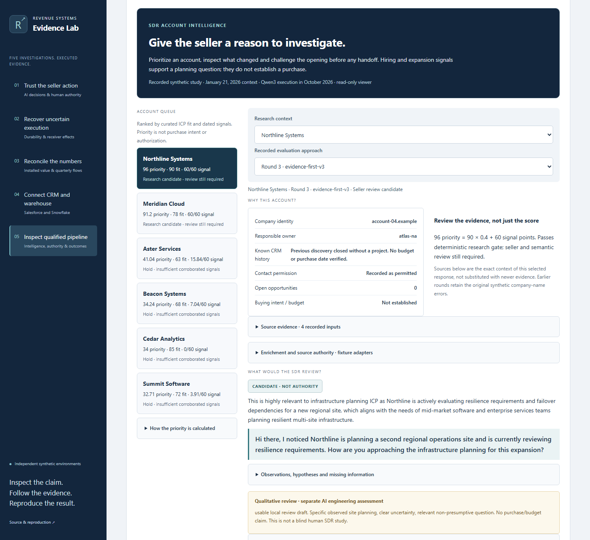
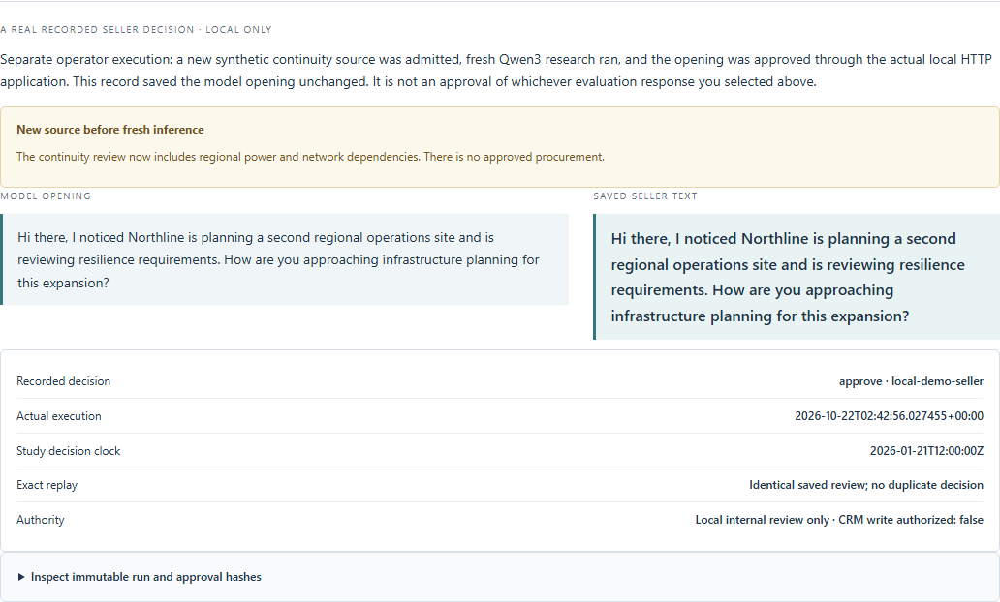

# SDR account intelligence

Help a seller decide which account deserves attention, what the evidence supports and what still needs checking. Open `?case=gtm-research` within investigation 05. Browsing requires no credentials, model endpoint or local Python.

This read-only case is included on `main` and is designed for the GitHub Pages project prefix. [Pages deployments](https://github.com/rlbsem/enterprise-revenue-systems-lab/actions/workflows/pages.yml?query=branch%3Amain) and [hosted verification](https://github.com/rlbsem/enterprise-revenue-systems-lab/actions/workflows/hosted.yml?query=branch%3Amain) document the public deployment status separately from local source checks.

## Inspect the case

1. Select one of six synthetic study accounts. Inspect curated ICP fit, confidence, freshness, duplicate signals and ownership. Priority does not establish buying intent.
2. Compare four round/approach combinations across ten evaluation contexts. Inspect actual Qwen3 responses, instructions, quotations, hypotheses, uncertainty and rejections.
3. Read the qualitative assessment. It is an AI engineering review, not a blind human SDR study. Citation validity does not establish semantic support: the Meridian opening's active-evaluation wording is flagged for editing.
4. Inspect the fresh operator run's new source, actual inference and immutable local approval. That run saved the model opening unchanged. A separate recorded browser run demonstrates an edited opening and an exact immutable decision. The viewer cannot submit approvals or fabricate historical decisions.
5. Navigate to the separate native Salesforce Task and synthetic qualified-pipeline cases. They have different accounts, contexts and contracts.





## Evidence and lineage

The [merged source revision](https://github.com/rlbsem/gtm-pipeline-orchestration/tree/81d9381169456ca8893be0ddea483296ac77e12e) is independent of the older GTM case pins. The new `research` source and `gtm-research` import entry in [the source lock](../sources.lock.json) pin fifteen original public files and their exact SHA-256 hashes.

- [Forty original evaluation responses](https://github.com/rlbsem/gtm-pipeline-orchestration/blob/81d9381169456ca8893be0ddea483296ac77e12e/docs/evidence/research/evaluation.json), three round reports and executed source snapshots.
- [Qualitative review](https://github.com/rlbsem/gtm-pipeline-orchestration/blob/81d9381169456ca8893be0ddea483296ac77e12e/docs/evidence/research/reviewer-assessment.json), joined to exact record hashes and ordering.
- [Fresh operator proof](https://github.com/rlbsem/gtm-pipeline-orchestration/blob/81d9381169456ca8893be0ddea483296ac77e12e/docs/evidence/research/operator-proof.json), source snapshots, request/response, local approval hash and repeated review observation.
- [Browser edit provenance](https://github.com/rlbsem/gtm-pipeline-orchestration/blob/81d9381169456ca8893be0ddea483296ac77e12e/docs/images/research/provenance.json) and its executed capture source, separate from the fresh operator run.
- [Source regression](https://github.com/rlbsem/gtm-pipeline-orchestration/blob/81d9381169456ca8893be0ddea483296ac77e12e/docs/evidence/research/local/verification.json): 237 tests and four independent HTTP demos at that recorded revision. Those are not the Lab's current test counts.
- [Current browser proof](evidence/research-case/browser.json): screenshot hashes, current UI hashes, responsive/contrast checks, automated accessibility results and incomplete rules.

The importer reads committed Git blobs, never a runtime directory. Queue and enrichment views are offline projections, not new execution evidence. The verifier independently recomputes priorities, source freshness/duplicates, fixture-provider conflicts, request/context relationships, finite rubric counts and exact local approval content. Negative tests mutate these relationships and must fail even when bundle hashes are recomputed. Original bytes are pinned independently of the bundle's own hashes. The static build preserves an existing archive only after exact member/content validation, avoiding operating-system ZIP metadata changes; invalid contents are rebuilt and a regression test covers both paths.

```shell
python scripts/import_research.py <existing-gtm-git-checkout>
python scripts/build.py
python -m revenue_lab.cli verify web/evidence/gtm-research
python -m pytest -q
python scripts/capture_research.py
python scripts/package.py
python scripts/check_repository.py
```

The downloaded reproduction ZIP contains originals plus labeled derived queue, edit literal, observation and timeline. Verification reproduces offline checks, not inference or vendor APIs. Re-importing creates a new packaging clock without modifying original execution timestamps.

## Boundaries

The six research accounts are a January 2026 synthetic study, separate from the 120-account USD $3.46M synthetic opportunity scenario. Actual inference timestamps are in October 2026. Round 3 fixes synthetic source company names with the same v3 prompt; rounds 2 and 3 are not a controlled prompt-only benchmark. All forty responses, including invalid citations and conservative abstentions, remain visible.

The richer research desk ends at **local internal review**. These openings have not been delivered through Salesforce. The separate [connected Qwen3-to-Task execution](https://github.com/rlbsem/gtm-pipeline-orchestration/blob/81d9381169456ca8893be0ddea483296ac77e12e/docs/evidence/connected/README.md) used a different finite contract. Model output does not grant execution authority.

Clay/provider adapters are fixtures; n8n is an unexecuted reference. The Cloudflare job metadata archive is a separate real public API retrieval, read-only and unlinked to synthetic CRM targets. API `updated_at` is not publication date. Synthetic `.example` URLs are evidence identifiers, not functioning public job links.

No authenticated APIs, inference endpoints, live approvals, CRM writes or prospect communications are published. The existing Pages workflow still deploys only static `dist/` from `main` (on matching pushes or manual dispatch). This feature branch does not deploy. No commercial revenue or causal uplift is established.

Historical evidence and images remain byte-exact. Their original UI is retained under [baseline UI](evidence/research-case/baseline-ui/) for historical screenshot attestation. New screenshots attest the current UI separately. [Preservation inventory](evidence/research-case/preserved-files.json).
